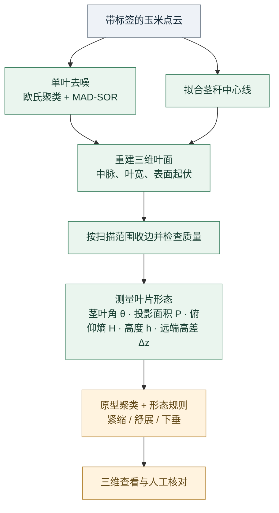

# 玉米点云三维表型分析

从带叶片标签的玉米点云重建三维叶面，提取表型并进行叶姿分类，支持整株与单叶交互查看。当前本地数据为 **14 株、90 片叶**。

## 处理流程



`P` 是同株归一化后的水平投影面积，`h` 是叶基相对扫描茎秆的高度，`Δz` 是叶面距茎秆最远端与叶基的高度差（`z_far - z_base`）。具体步骤见[完整技术路线](docs/路线.md)。

## 方法选择的依据

- **数学依据：** 连通图和稳健统计用于去噪，样条与局部坐标用于叶面重建，面积积分、向量夹角和信息熵用于测量。每项公式和源码对应见[数学依据](docs/method-basis.md#数学依据)。
- **植物依据：** 玉米的叶片—叶鞘连接区参与叶角形成；叶形和中脉结构与株型有关，分别有 [Wang 等（2022）](https://doi.org/10.1093/plphys/kiac308)、[Dornbusch 等（2011）](https://doi.org/10.1093/aob/mcq181) 和 [Strable 等（2017）](https://doi.org/10.1105/tpc.16.00477) 的研究支持。它们支持关注这些形态特征，没有直接验证本项目的分类阈值。
- **参数依据：** 去噪参数有[欧氏聚类](docs/validation/euclidean_cluster_calibration_2026-11-25.json)和[MAD-SOR](docs/validation/sor_calibration_2026-11-24.json)的本地标定记录。高度权重 `1.0`、远端高差权重 `1.0`、顶部范围 `0.15`、面积比例 `0.5`、距离比 `2/3` 属于当前开发设置，尚无独立生理标签验证。详见[参数来源与验证状态](docs/method-basis.md#参数来源与验证状态)。

## 快速开始

在项目根目录安装依赖：

```bash
python -m pip install -r requirements.txt
```

已有本地重建结果时，直接打开查看器：

```bash
python scripts/visualize.py
```

从原始数据完整运行，依次执行四个阶段：

```bash
python scripts/run.py                              # 1. 点云去噪与三维叶面重建
python scripts/extract_traits.py                   # 2. 提取几何表型与信息熵
python scripts/classify_leaf_pose.py               # 3. 五因素叶姿分类
python scripts/visualize.py                        # 4. 交互查看
```

输入放在 `dataset/`：同名 TXT 点云与 CSV 标签文件配对，CSV 的 `semantic` 列中 0 表示茎秆，正整数表示叶片编号。原始数据只读；新实验请通过各入口的路径参数指定新的输出目录，参数用 `--help` 查看。

## 分类与显示

分类采用 **茎叶角、同株相对投影面积、俯仰角信息熵、相对着生高度、远端相对叶基高度差** 五个因素，学习三个全局形态原型，再按规则命名为紧缩、舒展、下垂。紧缩候选限于符合顶部、小投影面积条件的叶片；**每株可以缺少某些类别，不强制凑齐三类**。这些标签描述形态，叶龄、衰老状态和光合能力需要另外测量。

查看器支持点选叶片和类别筛选，默认保留整株背景并显示观测支撑面；可切换“仅看选中叶”和“显示插值/外推面”。当前重建分别约束左右观测边缘，截断叶尖保持开放。

导出可直接打开的离线查看器：

```bash
python scripts/visualize.py --export-viewer outputs/classification_v2/viewer
```

## 目录与结果

| 路径 | 用途 |
|---|---|
| `dataset/` | 原始点云与标签 |
| `scripts/` | 各阶段运行入口，每阶段 1–2 个 |
| `src/maize_leaf/` | 算法、验证模块与查看器模板 |
| `outputs/maize_v2/` | 当前三维模型、网格与质量审计 |
| `outputs/phenotypes_v2/` | 逐叶、逐株表型表与元数据 |
| `outputs/classification_v2/` | 分类表、报告与离线查看器 |
| `docs/`、`tests/` | 方法、验证记录与回归测试 |
| `outputs/archive/`、`.cache/` | 历史归档与运行缓存 |

原始数据、生成结果和环境依赖按 `.gitignore` 保留在本地，不随 Git 仓库分发。

## 测试与验证

```bash
python scripts/run_tests.py                 # Python 测试；安装 Node.js 时同时检查前端逻辑
python scripts/validate.py --help           # 贴合审计、遮挡留出、参数标定等
python scripts/plot_validation.py --help    # 已有验证结果的诊断绘图
```

- [各阶段脚本与参数](scripts/README.md)
- [完整技术路线：每个环节的具体步骤](docs/路线.md)
- [数学与生理依据：公式、文献及参数来源](docs/method-basis.md)
- [算法、分类规则与适用范围](docs/method.md)
- [近期分类与曲面修正验证记录](docs/validation/classification_feedback_2026-11-25.json)
