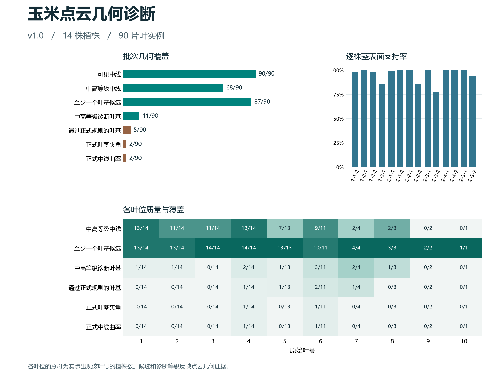

# Maize 3D Phenotyping · v1.0

自动分析玉米三维点云中的茎秆、叶片可见中线与叶基。流程以语义标签和配套原始点云为输入，输出几何诊断、质量分级和通过质量门槛的表型特征。

在 14 株、90 片叶的验证批次中，90 片叶提取了可见中线，68 片中线达到中高质量等级，87 片有叶基候选。正式夹角和曲率均覆盖 2 片叶，来自同一株。质量等级反映几何证据和稳定性，数据分析以植株为独立样本单位。

## 输入

- CSV 含 X、Y、Z、semantic 四列。标签 -1 表示背景，0 表示茎秆，每个正整数表示保留原编号的独立叶片。
- 每个 CSV 对应一个同名 TXT。TXT 第一行为 CloudCompare 风格字段名，第二行为点数，随后是原始点行。CSV 与 TXT 须满足点数、坐标及标签逐行一致。
- 使用自己的点云设置输入目录。可以通过 MAIZE_DATA_DIR 环境变量配置 CSV 目录，或在仓库根目录的 .maize-data-dir 单行填写本机路径。分析命令支持独立的 --txt-dir 参数。

## 运行

~~~shell
python -m pip install -r requirements.txt
python run_analysis.py --version
python run_analysis.py --batch --data-dir path/to/csv --txt-dir path/to/txt
python run_analysis.py --sample 1-1-2 --data-dir path/to/csv --txt-dir path/to/txt
python view_pointcloud.py --file path/to/1-1-2.csv --raw
python -m unittest discover -s tests -v
~~~

每次分析会创建独立的批次目录。目录内包含全叶片特征、逐株汇总、叶位汇总、叶序诊断、质量报告、总览和逐株核验图。用查看器的 --results-dir 指向该批次即可叠加茎线、可见中线和叶基候选，--leaf 可聚焦某一叶片。

几何算法以稳健茎秆中心线和截面表面模型为基础，比较多种叶片中线和叶基候选方法。height_ratio_raw、diagnostic_* 和 visible_midline_length 是诊断字段。leaf_angle_deg、curvature_rms_norm 等正式字段只有通过对应质量规则才有值。原始数据与逐株分析产物保存在本机。
