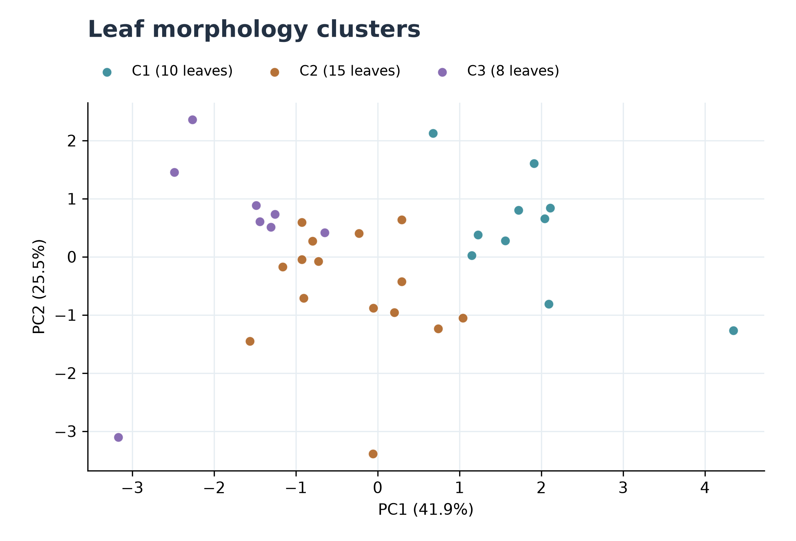

# Maize 3D Phenotyping

从带语义标签的玉米三维点云定位茎叶最近点对，测量可见叶片的几何特征，并按形态或叶基高度做逐株分类。结果保留原始植株编号、叶号、点数据行号、输入哈希和质量状态，可以从报告追溯到原始点云。

[复现步骤](#从原始点云复现) · [交互查看器](#交互查看器) · [V1.0 发布](https://github.com/YueHuaNian/maize-3d-phenotyping/releases/tag/v1.0) · [V6 历史归档](archive/legacy-v6-baseline-2026-11-19/README.md)

## 项目能做什么

| 分析 | 方法与输出 |
|---|---|
| **V1.0 叶基定位** | 对每株的有效茎点建 cKDTree，查找每片叶全部有效点到茎的全局欧氏最短点对。输出最近点、距离、源行号和逐株三维图。 [算法](docs/ALGORITHM.md) · [实验报告](outputs/v1.0/V1.0_EXPERIMENT_REPORT.md) |
| **V1.1 表型提取** | 根据最近点对、稳健茎线和可见叶中线测量叶茎夹角、归一化着生高度、下垂指数、归一化 RMS 曲率、水平延展指数和倾角 Shannon 熵。逐项通过质量筛查后写入主结果字段。 [数学定义和质量规则](docs/V1.1_METHODS.md) |
| **V1.1 整批聚类** | 只用六项特征齐全的叶片拟合 StandardScaler 和 K-means（K=3），以逐株留出评估本批次的复算稳定性。 [分析报告](outputs/v1.1/V1.1_ANALYSIS_REPORT.md) · [逐株留出结果](outputs/v1.1/cluster_stability.csv) |
| **V1.1 逐株熵形态聚类** | 从原始叶点构建统一的观测剖面，每株独立拟合 K=3。Shannon 熵占平方距离权重的 55%，水平伸展、末端落差和下行段占比各占 15%。组名为 C1 聚拢型、C2 伸展型、C3 耷拉型。 [逐株报告](outputs/v1.1/plant_morphotypes/PLANT_CLUSTER_REPORT.md) · [逐叶分组与熵](outputs/v1.1/plant_morphotypes/leaf_clusters.csv) |
| **V2 高度优先分层** | 按最近茎点的 Z 高度连续划分上层 C1 聚拢型、中层 C2 伸展型、下层 C3 耷拉型。各株以加权簇内平方和最小选择两个切点。叶基高度权重 65%，观测方向 Shannon 熵 20%，水平伸展、末端落差和下行段占比各 5%。同高叶片在同一层。默认要求中层超过半数。若叶片数或同高叶片使多数不可达，则保留三层并最大化中层叶片数。 [默认分层报告](outputs/v2-middle-majority/HEIGHT_ORDERED_REPORT.md) · [原版自由切分](outputs/v2/HEIGHT_ORDERED_REPORT.md) |

V1.1 的拟合中线熵按中线方向计算，用于整批分析。逐株形态聚类和 V2 使用基于原始叶点剖面的观测方向熵。两种估计的计算口径和质量规则见方法文档。

综合评价随 `run_analysis.py` 输出。逐株 PAI 综合横向伸展及叶基高度分布，逐叶 LMI 综合观测方向熵、伸展及下垂。两个指数保留原始分量、状态和计算溯源。[公式与质量规则](docs/PAI_LMI_METHODS.md)

## 已验证的数据与结果

发布批次有 **14 株、325,818 个点、90 片叶**。14 对 TXT 和 CSV 全部通过逐行核验，90 片叶均获得最近点对。

- V1.1 整批模型纳入 33 片完整特征叶，轮廓系数为 0.255。逐株留出完成 14 折，留出标签一致率按叶数加权为 84.85%，按株等权为 77.38%。57 片叶通过拟合中线倾角熵的质量筛查。
- V1.1 逐株熵模型覆盖全部 90 片叶，观测方向熵中位数为 2.826 bit。聚拢型 25 片、伸展型 33 片、耷拉型 32 片。
- V2 的中层多数方案覆盖 14 株、90 片叶。上层 19 片、中层 56 片、下层 15 片。13 株中层超过半数。2-4-1 共有 4 片叶，保留三层时中层最多 2 片。中层多数是分层的预设条件。[逐株统计](outputs/v2-middle-majority/plant_summary.csv) · [逐叶分组与高度](outputs/v2-middle-majority/leaf_layers.csv)
- PAI 覆盖 14/14 株，中位数 30.61。LMI 覆盖 90/90 片叶，逐叶中位数 36.49。[综合评价报告](outputs/pai-lmi-baseline/PAI_LMI_REPORT.md)

原始坐标的物理单位待确认。最近点对是叶基的初始几何估计。遮挡、贴茎叶段和语义边界可能影响定位。形态簇与高度分层描述本批次的观测几何，跨批次解释与解剖叶基误差仍需独立数据验证。

## 从原始点云复现

### 1. 准备环境和数据

从仓库根目录执行以下示例。使用 Python 3.10 或以上，建议在独立的 Python 环境中安装依赖。发布批次使用 Python 3.14.10，具体依赖版本记录于 [V1.1 运行溯源](outputs/v1.1/run_provenance.json) 和 [逐株熵模型溯源](outputs/v1.1/plant_morphotypes/provenance.json)。

~~~sh
python -m pip install -r requirements.txt
~~~

原始点云存放在仓库外。复现发布批次需准备 [输入清单](outputs/v1.1/input_manifest.csv) 所列的 14 对文件，逐文件核对 SHA-256。可使用相同格式的自有数据运行完整流程。目录示例：

~~~text
maize-data/
├── csv/
│   └── 2-1-2.csv
└── txt/
    └── 2-1-2.txt
~~~

- 每株提供同名 CSV 和 TXT，文件名主体为植株编号，两种文件的点顺序一致。
- 两种文件采用 UTF-8 编码。CSV 首行为表头，包含大小写一致的 X、Y、Z 和 semantic 列，每个点占一行。
- TXT 第一行为以空格分隔的列名，可带 CloudCompare 常见的 // 前缀。第二行为点数，后续每行一个点。列名含 X、Y、Z、Constant，可另含 Constant_#2。若后者存在且该行取值为有效标签，则该行优先使用后者。以 nan 表示缺失时回退到 Constant。
- 语义值 −1 为背景或噪声，0 为茎秆，所有正整数各自代表一片叶。程序逐行核对点数、XYZ 和语义。点数据行号从 0 起算，两种文件的头部均排除。

### 2. 运行定位、批次分析和 V2 分层

将示例中的 path/to/csv 和 path/to/txt 换成自己的配对数据目录。每条命令使用一个新输出目录。

~~~sh
python -m src.nearest_attachment --data-dir "path/to/csv" --txt-dir "path/to/txt" --output-dir results/reproduction/v1.0

python run_analysis.py --sample 2-1-2 --data-dir "path/to/csv" --txt-dir "path/to/txt" --output-dir results/reproduction/sample-2-1-2

python run_analysis.py --batch --data-dir "path/to/csv" --txt-dir "path/to/txt" --output-dir results/reproduction/v1.1

python view_phenotypes_v2.py --results-dir results/reproduction/v1.1 --export-dir results/reproduction/v2-majority --export-only

python view_phenotypes_v2.py --results-dir results/reproduction/v1.1 --export-dir results/reproduction/v2-original --middle-size free --export-only
~~~

单株分析用于检查输入、最近点对、叶片特征和逐株聚类。整批六特征模型及逐株留出评估在跨株批次中拟合。V2 读取 V1.1 批次的叶基和观测剖面结果，导出时无需打开交互窗口。

单株和整批分析都会生成 `indices/`。用 `plant_indices.csv` 查看 PAI、逐株 LMI 中位数及覆盖率，用 `leaf_indices.csv` 查看逐叶 LMI 与各分量，并用 `PAI_LMI_REPORT.md` 汇总样本结果。

V1.1 的 CSV 目录也可通过 MAIZE_DATA_DIR 或项目根目录的 .maize-data-dir 指定，后者只写一行本机目录。TXT 目录可通过 MAIZE_TXT_DIR 指定。显式路径参数便于迁移和复现，V1.0 独立命令要求提供两种目录。

### 3. 检查结果和运行测试

~~~sh
python -m unittest discover -s tests -v
~~~

复现发布批次时，先比较 input_manifest.csv 的植株编号、点数和输入哈希，再对照各输出的行数、质量状态和分组。预期 V1.0 输出 90 个最近点对，V1.1 整批模型纳入 33 片完整特征叶，V1.1 逐株模型和 V2 均覆盖 14 株、90 片叶。真实样本测试会使用已配置的数据目录，其中配对测试沿用旧版约定，从 CSV 目录的同级 0709单天多个材料原始数据 查找 1-1-2.txt。

## 交互查看器

在 VS Code 选择项目的 Python 解释器，打开所需脚本，点击 **运行 Python 文件**。桌面查看器使用 Matplotlib 的图形后端，例如 TkAgg。

| 入口 | 用途 |
|---|---|
| [view_phenotypes.py](view_phenotypes.py) | V1.1 点云和最近点对。默认显示逐株熵聚类，有批次结果时也可通过 --cluster-scope batch 查看整批模型 |
| [view_phenotypes_v2.py](view_phenotypes_v2.py) | V2 高度优先方案。默认启用中层多数规则，可通过 --middle-size free 查看原版自由切分 |
| [view_pointcloud.py](view_pointcloud.py) | 历史 V6 查看器，用于原始点云及旧版几何叠加 |

前两个查看器默认使用 outputs/v1.1 和本机数据配置，也可通过 --results-dir、--data-dir、--txt-dir 指向复算结果和输入。左侧切换植株，右侧可单独显示一类。C1 蓝、C2 橙、C3 绿，叶号与点云同色。

运行 V1.1 后生成的 interactive/ 包含 plant_morphotypes_3d.html（逐株熵形态）、plant_geometry_3d.html（整批模型的逐株几何）和 cluster_3d.html（整批 PCA）。可在浏览器中离线查看，HTML 与配套的 plotly.min.js 需放在同一目录。

## 输出与代码位置

| 路径 | 内容 |
|---|---|
| [outputs/v1.0/](outputs/v1.0/) | 最近点对、距离统计、14 株三维图和实验报告 |
| [outputs/v1.1/](outputs/v1.1/) | 逐叶特征、逐株统计、输入与运行溯源、质量明细、整批模型及留出结果 |
| [outputs/v1.1/plant_morphotypes/](outputs/v1.1/plant_morphotypes/) | 逐叶熵形态分组、特征、簇中心和逐株计数 |
| [outputs/v2-middle-majority/](outputs/v2-middle-majority/) | 默认 V2 的 14 株复算报告、逐叶分层、逐株统计和运行溯源 |
| [outputs/v2/](outputs/v2/) | 原版自由切分的逐叶高度分层、逐株切点、复算参数和来源哈希 |
| [outputs/pai-lmi-baseline/](outputs/pai-lmi-baseline/) | 14 株的 PAI 与 LMI 复算报告、逐株和逐叶指标、分量、质量状态及运行溯源 |
| [run_analysis.py](run_analysis.py)、[src/](src/)、[tests/](tests/) | V1.1 分析入口、实现与测试 |

## 开发分支

日常开发、提交和测试在 `dev` 进行。`main` 用于发布，经项目维护者明确要求后才合并 `dev`。
