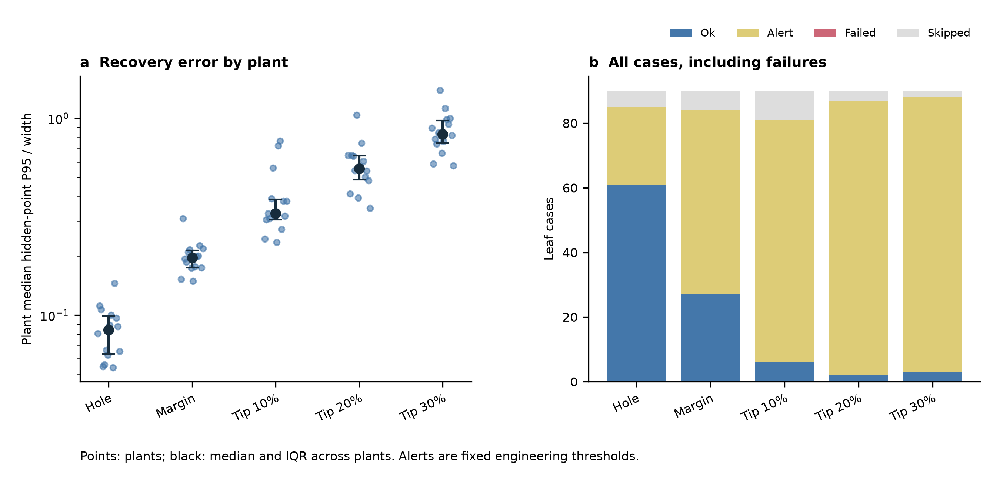
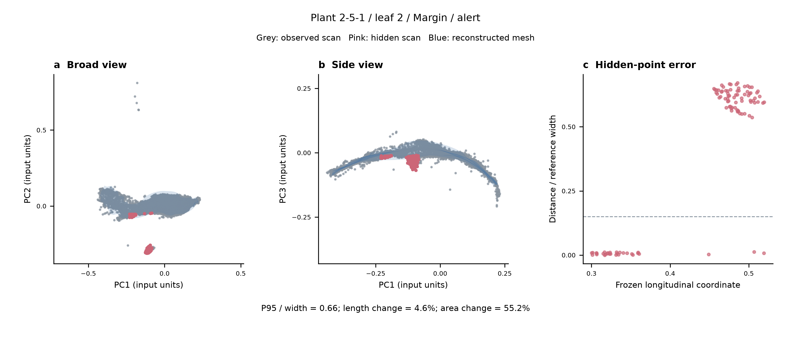
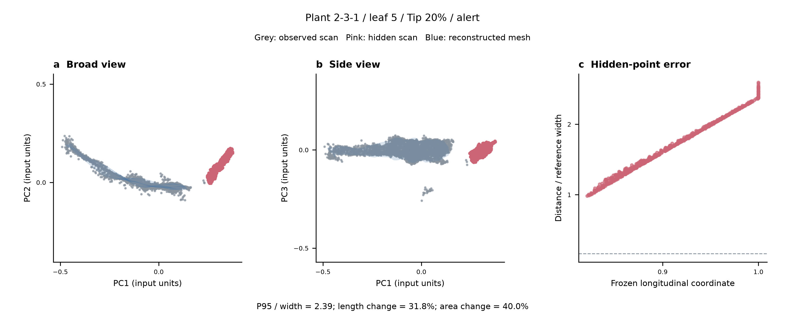

# 玉米叶片三维重建：逐步算法、公式与实现

本文档说明当前实现的核心算法、数学公式与输出规范。模型与检查报告统一保存至 `outputs/`，原始点云保持只读；几何长度与面积沿用输入点云的坐标单位。

## 1. 输入、输出与完整流程

输入为已带语义编号的玉米点云（`semantic=0` 为茎秆，正整数为各叶片）。每片叶最终重建为一个可保存、加载与连续求值的参数曲面：

$$
S(s, v) = C(s) + \frac{v\,w_{\mathrm{eff}}(s)}{2} b(s) + \widetilde{q}(s, v) n(s), \quad s \in [0, L],\ v \in [-1, 1].
$$

其中 $C$ 为参考曲线，$(t, b, n)$ 为局部正交标架，$w_{\mathrm{eff}}$ 为横向宽度，$\widetilde{q}$ 为法向起伏。曲面中心轨迹定义为 $M(s) = S(s, 0)$，表型叶长沿 $M(s)$ 数值积分计算；即便参考曲线取直线，纵向弯曲仍由高度场完整表达。

| 顺序 | 输入 | 处理 | 实现与输出 |
|---|---|---|---|
| 1 | 同名 TXT、CSV | 配对、读取、法向归一化 | `io.discover/load_pair`：点、标签、颜色、法向 |
| 2 | 单叶点与法向 | 去重、连通簇保留、逐断片 SOR | `geometry.clean_leaf_points`：保留点 |
| 3 | 茎秆点 | Z 分箱中位点、有界 P-spline | `fit_stem_centerline`：参考茎秆线 |
| 4 | 叶片点、茎秆线 | L1 骨架、测地排序、主曲线、范围回退 | `extract_midrib`：初始参考中脉 |
| 5 | 曲线、法向 | 双反射标架、测量法向滚转对齐 | `build_normal_aligned_frame`：局部标架 |
| 6 | 初始几何 | 鲁棒联合优化及多种参考曲线 | `joint.py`、`surface.fit_leaf`：几何候选 |
| 7 | 局部横向坐标 | 宽度包络、先验收缩、BIC 截断检验 | `morphology.py`：叶形和补全长度 |
| 8 | 高度与有效宽度 | 分箱 TPS、GML、叶尖闭合 | `surface.py`：连续曲面 |
| 9 | 候选曲面 | 局部翻转筛选、同点集贴合选优 | `surface.fit_leaf`：选中模型 |
| 10 | 模型与点云 | 连续性、网格、贴合复查，表型与导出 | `quality.py`、`pipeline.py` |

## 2. 配对读取和坐标约定

`discover` 递归读取首行以 `//X Y Z` 开头的 TXT，与同名 CSV 配对。CSV 提供 `X,Y,Z,semantic`，TXT 提供 RGB 和可用的 `Nx,Ny,Nz`。单位法向为：

$$
\widehat{n}_i = n_i / \max(\|n_i\|_2, 10^{-12}).
$$

两份文件需保持一致的点数、点序与空间坐标（本地 14 对输入逐行坐标差均为零），以确保颜色与法向逐点对齐。茎秆拟合默认以 Z 轴为高度方向。

## 3. 去重、断片保留与稳健去噪

### 3.1 半径连通图

按完整 XYZ 精确去重，同步保留法向。最近非自身点距中位数记为 $d_{\mathrm{sp}}$，采用各轴 1%–99% 分位数之差构成的稳健包围盒对角线长度记为 $D_{\mathrm{rob}} = \|Q_{0.99}(p) - Q_{0.01}(p)\|_2$。建图半径为：

$$
r = \max(5\,d_{\mathrm{sp}}, 0.02\,D_{\mathrm{rob}}).
$$

使用 `cKDTree.sparse_distance_matrix` 构建无向半径图，保留最大连通分量及点数满足 $N_c \ge \max(20, \lfloor 0.01\,N \rfloor)$ 的连贯断片，使稀疏或间断的远端叶尖得以完整参与后续拟合。

上述半径公式与次簇保留阈值经全量 14 株 / 90 片叶的三级敏感性实验（`scripts/validate_euclidean_clustering.py`，固定种子 `2026`，下游固定为已标定分断片 MAD-SOR，扫描 56 组半径定义 × 18 组次簇规则共 1,009 组配置）标定：原始全极差对角线 `np.ptp` 易被远端孤立飞点放大（本批实测叶片中位放大 `1.18×`、最大 `2.09×`；扰动实验 P95 半径膨胀 `1.56×`），导致连通半径过大并吞入近叶误标簇；改用 $D_{\mathrm{rob}}$ 并取 $r = \max(5\,d_{\mathrm{sp}}, 0.02\,D_{\mathrm{rob}})$ 后半径膨胀归零（P95 `1.01×`），Level 2 株均 MCC 由 `0.754` 升至 `0.868`、原始实测自然离面点（`>5 d_sp`）召回率由 `10.3%` 升至 `20.7%`、Level 3A 扰动端到端叶面积误差由 `4.38%` 降至 `2.76%`；次簇阈值消融同时证实 `max(20, 1% N)` 处于全网格最优点（仅留最大簇会使 90 叶实测中位叶面积缩水 `8.9%`）。

### 3.2 各断片独立 SOR

复用了第 3.1 节单次连通分量划分结果（不在删簇后缩小半径二次切分，避免产生孤立小碎点绕过 SOR）。在每个保留分量（点数 $\ge 20$）内取最多 $k = 8$ 个非自身近邻，计算每点的近邻平均距离 $\bar{d}_i$，采用单参数中位数/MAD 稳健阈值：

$$
m = \operatorname{median}(\bar{d}_i), \qquad \sigma_{\mathrm{rob}} = 1.4826\operatorname{median}\lvert \bar{d}_i - m \rvert,
$$

$$
\tau = m + 3.5\,\sigma_{\mathrm{rob}}.
$$

当规则合成网格导致 $\sigma_{\mathrm{rob}} \le 10^{-12}$ 时，尺度退回 $\operatorname{std}(\bar{d})$。保留 $\bar{d}_i \le \tau$ 的点；若一次筛选剩余不足 $\max(15, \lfloor 0.75\,N_c \rfloor)$ 则撤销本次筛选，保护稀疏叶尖不被过度裁切。

邻域统计去噪思想参见 [PCL 官方 SOR 说明](https://pointclouds.org/documentation/classpcl_1_1_statistical_outlier_removal.html)。$k = 8$ 与 $\alpha = 3.5$ 的取值由全量 14 株 / 90 片叶的三级敏感性实验（`scripts/validate_sor_sensitivity.py`，固定种子 `2026`，282 组 $k \in [6, 50]$ × 4 种阈值族对比）标定：在二维薄片叶片上，$k > 12$（如 PCL 教程默认 $k = 50$）会随 $\sqrt{k}$ 放大内点邻域半径、稀释近叶飞点对比度并加剧叶尖误删；$k = 6$ 对 3–5 点成团毛刺召回率偏低；$k = 8$ 搭配 $\tau = m + 3.5\,\sigma_{\mathrm{rob}}$ 在注噪端到端重建（14 株全通过，中位叶宽误差 `1.86%`、叶面积误差 `6.38%`）及全量 90 叶原始实测审计（90/90 通过，模型中立原始点 P95 最低且中位叶长/叶面积与基线偏差在 `1.2% / 0.8%` 内）中取得最佳综合平衡。

## 4. 公共拟合器：有界 P-spline 与 GCV

给定节点参数 $t_i$、观测 $Y_i$ 和 B-spline 基矩阵 $B$，求系数 $A$：

$$
\min_A \|W^{1/2}(BA - Y)\|_F^2 + \lambda\|D_2 A\|_F^2.
$$

$D_2$ 是控制系数的二阶差分。默认三次样条、请求 10 个基函数，实际次数/基数受节点数限制；内节点均匀、端点夹持。默认权重为 1。无界平滑器为：

$$
H_\lambda = B_w(B_w^T B_w + \lambda D_2^T D_2 + 10^{-12}I)^{-1} B_w^T,
$$

$$
\mathrm{GCV}(\lambda) = \frac{\operatorname{mean}|Y_w - B_w A_\lambda|^2}{\max(1 - \operatorname{tr} H_\lambda / n, 10^{-4})^2}.
$$

在 $\log_{10}\lambda$ 上作有界一维优化，默认区间 $[10^{-3}, 10^4]$，各调用可另设。`bounded=True` 时再用堆叠最小二乘，将每轴控制系数限制于输入坐标范围外扩 2% 的盒内，坐标跨度下限为 $10^{-5}$。

通过无界线性解快速确定 GCV 最优平滑参数 $\lambda$ 后，再结合 2% 外扩盒约束求解控制系数，兼具自适应平滑能力与防过冲稳定性；差分惩罚背景见 [Eilers & Marx (1996)](https://doi.org/10.1214/ss/1038425655)。

## 5. 茎秆参考线

按 Z 分为 $\min(50, \max(8, \lfloor N / 40 \rfloor))$ 箱；每箱至少三点才取三维中位点 $P_j$。用弦长参数：

$$
t_0 = 0, \qquad t_j = t_{j-1} + \|P_j - P_{j-1}\|_2.
$$

调用有界 P-spline 拟合连续中心线，保存样条参数并采样 160 点，用于确定各叶片的叶基着生起点。

## 6. 骨架、测地排序与初始中脉

### 6.1 L1 中位收缩

随机种子默认 2026。最多取 2400 个参考点 $Q$，通过最远点采样布置最多 180 个种子 $X$，请求数量为 $\min(180, \max(24, \lfloor \lvert Q \rvert / 10 \rfloor))$，参考点不足时全取。

带宽 $h$ 从 $\max(0.12\,D, 6\,d_{\mathrm{sp}})$ 开始，每两轮扩大 1.15 倍，上限为 $\max(0.24\,D, h_{\mathrm{initial}})$，共 10 轮。定义：

$$
\theta(d) = e^{-4d^2/h^2}, \quad \alpha_{ij} = \frac{\theta(\|x_i - q_j\|)}{\max(\|x_i - q_j\|, 10^{-4}h)},
$$

$$
A_i = \frac{\sum_j \alpha_{ij} q_j}{\sum_j \alpha_{ij}}, \quad \beta_{ii'} = \frac{\theta(\|x_i - x_{i'}\|)}{\max(\|x_i - x_{i'}\|^2, (0.06h)^2)}.
$$

局部加权协方差最大特征值占总和的比例为方向线性度 $\sigma_i$，更新：

$$
x_i \leftarrow A_i + 0.28\,\sigma_i \frac{\sum_{i' \ne i} \beta_{ii'}(x_i - x_{i'})}{\sum_{i' \ne i} \beta_{ii'}}.
$$

斥力向量长度截断至 $0.25h$。针对单叶一维主脊提取任务，本文采用 [Huang et al. (2013)](https://doi.org/10.1145/2461912.2461913) 的局部 $L_1$ 吸引与方向斥力收缩算子，直接引导骨架节点向中心脊线收敛。

### 6.2 测地排序与缺口桥接

在骨架点上建立 8 近邻无向图，边权为欧氏距离（通用 `geodesic_order` 默认 12 近邻）。若图不连通，从最大分量出发按最近点对依次桥接，将跨缺口断片统一纳入同一测地坐标序。以距茎秆最近的骨架点作为起点运行 Dijkstra，分箱取三维中位点拟合初始曲线。

### 6.3 弧长与点投影

沿样条取 400 点，按折线累计长度进行弧长重参数化并拟合 P-spline。投影先从 300 个曲线采样点定位初值，再作 5 次牛顿更新：

$$
s \leftarrow s - \frac{(C(s) - p)\cdot C'(s)}{C'(s)\cdot C'(s) + (C(s) - p)\cdot C''(s)}.
$$

单步更新限幅 $\pm 0.05\,L$ 且参数约束在 $[0, L]$ 内，随后执行两轮“投影—弧长分箱中位点—样条—弧长重参数化”主曲线迭代。

### 6.4 端点与范围回退

初始两端暂沿切线延伸 15%，用全体点重投影的 0.5%–99.5% 参数分位数确定细化区间，消除骨架收缩引起的端点内缩。

若参考曲线在点云第一主轴上的范围不足点云 1%–99% 分位跨度的 95%，或沿该轴的累计回退超过跨度的 8%，自动切换为沿第一主轴 32 分箱的中位点拟合，保障宽大叶片的中脉贯通两端。

## 7. 双反射标架与法向对齐

单位切线为 $T = C' / \Vert C' \Vert$。定义反射 $R_a(x) = x - 2a(a\cdot x)/(a\cdot a)$，先用 $a = P_{i+1} - P_i$ 反射当前参考法向和切线，得到 $n_L, t_L$；再用 $b = T_{i+1} - t_L$ 作第二次反射得到下一法向，退化反射向量时采用正交投影回退；横向轴由 $B = N \times T$ 给出。方法见 [Wang et al. (2008)](https://i.cs.hku.hk/GraphicsGroup/publications/pdf/Computation%20of%20rotation%20minimizing%20frames.pdf)。

沿弧长设置 10–30 个窗口，将扫描法向投影到切线的正交平面，取散度矩阵主方向以消除正负号影响（无扫描法向时由局部截面协方差方向替代）。相对参考标架的滚转角用：

$$
\phi_{\mathrm{raw}} = \frac{1}{2}\operatorname{unwrap}\bigl(2\operatorname{atan2}(\sin\phi, \cos\phi)\bigr).
$$

三点中值滤波后，用最多 8 个基函数、$\lambda \in [10^{-2}, 10^4]$ 的 P-spline 平滑滚转角并旋转参考标架，使局部法向自然贴合叶片扭转；查询任意弧长时经线性插值后重新归一化并正交化。

## 8. 联合几何优化

37 维状态包含：横向位移 8、法向位移 8、滚转 6、一次/二次横向拱度各 5、叶宽形状参数 5。最多取 1200 个沿弧长分层点，以 22 箱提取叶缘锚点。

$$
C_\Theta = C_0 + \delta_b(u) b_0 + \delta_n(u) n_0, \quad q_\Theta(u, v) = a_1(u)v + a_2(u)v^2.
$$

残差包括：

1. 法向高度 $[h_i - q_\Theta(u_i, v_i)] / w_{\mathrm{scale}}$，点级权重 $1/\sqrt{N}$。
2. 预测单位法向与扫描法向叉积长度，权重 $0.35/\sqrt{N}$；预测法向结合拱度解析偏导与参考切线计算，对 $\pm 180^\circ$ 法向翻折保持不变性。
3. 左右越界、较完整侧对齐和 `tanh` 饱和双侧平衡项，显著降低单侧大缺口对中脉的牵引。
4. 中脉二阶差分、位移锚定、滚转平滑、拱度与叶形先验项。

采用 `least_squares(loss='soft_l1', f_scale=0.08, max_nfev=65)` 求解，标量鲁棒损失为 $\rho(z)=2(\sqrt{1+z}-1)$。优化收敛后提取横向与法向中脉位移，重新拟合曲线并更新标架；叶宽轮廓与二维 TPS 曲面在后续阶段基于完整局部点云高精度重算。

## 9. 宽度剖面、形态先验和 BIC

### 9.1 局部物理坐标

$$
r_i = (p_i - C(s_i))\cdot b(s_i), \quad h_i = (p_i - C(s_i))\cdot n(s_i).
$$

沿参考弧长分 32 箱，至少六点才使用。取 $w_L = \max(0, -Q_{0.02}(r))$、$w_R = \max(0, Q_{0.98}(r))$。一般 $w_{\mathrm{obs}} = w_L + w_R$；两侧差超过较大侧的 75% 时，用 $2\max(w_L, w_R)$ 估计缺失侧。

### 9.2 分段幂函数

令 $u = s / L$，最宽位置为 $x_m$：

$$
w_D(s) = \begin{cases}
w_{\max}\bigl[1 - (1 - k_{\mathrm{lig}})\bigl((x_m - u)/x_m\bigr)^{c_2}\bigr], & u \le x_m, \\
w_{\max}\bigl[1 - \bigl((u - x_m)/(1 - x_m)\bigr)^{c_1}\bigr], & u > x_m.
\end{cases}
$$

$c_1, c_2 > 1$ 时最宽处一阶连续，叶尖宽度为零。该参数化基于 [Dornbusch et al. (2011)](https://pmc.ncbi.nlm.nih.gov/articles/PMC3077976/) 的基部/尖部分段建模思路。轮廓解析面积系数为：

$$
\alpha = x_m\left(1 - \frac{1 - k_{\mathrm{lig}}}{c_2 + 1}\right) + (1 - x_m)\frac{c_1}{c_1 + 1}.
$$

玉米默认先验均值设为 $(x_m, k_{\mathrm{lig}}, c_1, c_2) = (0.36, 0.62, 1.85, 2.00)$，标准差为 $(0.10, 0.16, 0.45, 0.55)$。

### 9.3 数据集先验收缩

至少 800 个原始点、末端宽度比例小于 0.22 的候选完整叶先禁止延长拟合。再保留 $0.20 < x_m < 0.55$、$1.2 < c_1 < 3.2$、$0.65 \le \alpha \le 0.82$ 的结果。少于三个有效样本时沿用默认先验，否则以 $\omega = n / (n + 10)$ 将样本中位数向默认先验均值经验贝叶斯收缩（标准差类似收缩并保留下限），实现数据集自适应同时防止小样本坍缩。

### 9.4 是否延长叶尖

先拟合 $M_0$：固定 $L = L_{\mathrm{obs}}$ 的五参数模型，`soft_l1`、`f_scale=0.12`、`max_nfev=400`，先验残差权重 0.08。若允许补全且末端宽度比 $t > 0.22$，由先验反演：

$$
u_{\mathrm{end}} = \mu_x + (1 - \mu_x)\max(1 - \min(t, 0.85), 0.05)^{1/\mu_{c1}},
$$

$$
L_{\mathrm{prior}} = \operatorname{clip}\left(\frac{L_{\mathrm{obs}}}{\max(u_{\mathrm{end}}, 0.65)}, L_{\mathrm{obs}}, 1.45\,L_{\mathrm{obs}}\right).
$$

$M_1$ 自由长度上限为 $\min(1.45\,L_{\mathrm{obs}}, 1.15\,L_{\mathrm{prior}})$，同时估计长度和五个形状参数，先验权重提高至 0.45。使用归一化宽度数据残差：

$$
\mathrm{BIC} = n\log(\mathrm{RSS}/n) + k\log n.
$$

仅当满足正贝叶斯证据判据（$\mathrm{BIC}(M_1) + 4 < \mathrm{BIC}(M_0)$）时才延长叶尖，避免对完整叶片过度外推。

## 10. 中脉外推与实测宽度支持

### 10.1 中脉外推

拟合最后 25% 参考曲线的俯仰角 $\theta = \arcsin(t_z)$ 对弧长的斜率，取 $\kappa \leftarrow \min(\kappa, 0)$；保持末端平均水平方位：

$$
\theta(\delta) = \max\bigl[-0.48\pi,\; \theta_{\mathrm{end}} + \kappa\delta e^{-0.5\delta/L_{\mathrm{obs}}}\bigr].
$$

沿弧长离散积分单位切线，连接观测段与外推点重新拟合样条并延续参考标架，使补全段符合玉米叶片自然下垂形态。

### 10.2 有效宽度

为完整保留实测叶缘，每箱计算局部支撑修正：

$$
e_j = \max\bigl[2\max(w_{L,j}, w_{R,j}) - w_D(s_j),\; 0\bigr], \quad w_{\mathrm{eff}}(s) = w_D(s) + e(s).
$$

PCHIP 连接修正值，起点延用首箱值，观测末端补零，观测区外修正为零。`axis`、`linear` 候选先用最多 8 基函数、$\lambda \in [0.1, 100]$ 平滑修正轮廓，保持叶缘边界光顺。

## 11. 分箱中位 TPS 与谱 GML

训练坐标是 $u = s / L_{\mathrm{obs}}$、$v = \operatorname{clip}(2r / w_{\mathrm{eff}}(s), -1.25, 1.25)$。以 `(round(40u), round(12v))` 分箱，各箱取 $u, v, h$ 中位数；默认最多 350 个代表点，超过时按种子 2026 抽样。

$$
q(x) = \sum_j a_j\phi(\|x - x_j\|) + b_0 + b_1 u + b_2 v, \quad \phi(r) = r^2\log r, \quad \phi(0) = 0.
$$

构造核矩阵 $K$、多项式矩阵 $P = [1, u, v]$。对 $P$ 完整 QR 分解，以 $Q_2$ 表示多项式空间正交补：

$$
Q_2^T K Q_2 = U\operatorname{diag}(\eta_j)U^T, \quad z = U^T Q_2^T h.
$$

在 $\lambda \in [10^{-7}, 10^2]$ 上最小化：

$$
\mathrm{GML}(\lambda) = \left(\sum_j \frac{z_j^2}{\eta_j + \lambda}\right)\exp\left[\frac{1}{m - 3}\sum_j \log(\eta_j + \lambda)\right].
$$

$$
a = Q_2 U [z / (\eta + \lambda)], \quad b = R_1^{-1} Q_1^T(h - K a - \lambda a).
$$

`ThinPlateSplineGCV`（保留该类名以兼容导出接口）实际采用谱 GML 准则自动求解 $\lambda$，在扫描含离群毛刺时可稳健抑制过拟合欠平滑，参见 [Wahba (1985)](https://doi.org/10.1214/aos/1176349743)。

### 11.1 叶尖高度闭合

仅使宽度为零不够，横向 TPS 高度也必须收敛到一点。令 $q_0(s) = q(s, 0)$：

$$
a(s) = \operatorname{clip}\left(\frac{w_{\mathrm{eff}}(s)}{0.1\,w_{\max}}, 0, 1\right), \quad g(a) = a^2(3 - 2a),
$$

$$
q_{\mathrm{tip}}(s, v) = q_0(s) + g(a(s))\bigl[q(s, v) - q_0(s)\bigr].
$$

从而 $S(L, v) = S(L, 0)$。外推段再按 $w(s)/w(L_{\mathrm{obs}})$ 衰减法向残差。NPZ 保存 `apex_taper` 标志；旧文件缺少该标志时使用旧规则，保证审计读取旧文件时不会悄悄改变其几何。

## 12. 候选曲面、折叠筛选与选优

每片叶构造五种候选，不按植株名或叶号硬编码：

| 模式 | 参考曲线 | 联合位移 |
|---|---|---|
| `joint` | 初始化后联合几何细化 | 使用 |
| `initial` | 初始参考曲线 | 不使用 |
| `smoothed` | 初始曲线取 80 点，以 12 基函数、$\lambda\in[0.1,100]$ 再平滑 | 不使用 |
| `axis` | 第一主轴 24 箱中位点，8 基函数、$\lambda\in[1,10^4]$ 强平滑 | 不使用 |
| `linear` | 保留点第一主轴范围上的直线参考；纵向弯曲由高度场表示 | 不使用 |

### 12.1 局部翻转

用 241×61 参数网格，$s/L\in[0.01,0.99]$、$v\in[-0.98,0.98]$，以二阶精度差分计算：

$$
J_n = (\partial_s S \times \partial_v S)\cdot n(s), \quad c_n = J_n / \|\partial_s S \times \partial_v S\|.
$$

$c_n < -10^{-6}$ 为反向采样。先排除有反向采样的候选，再对剩余候选使用相同保留输入点、相同 220×61 曲面采样，计算点到面的近邻距离：

$$
d_i = \min_j \|p_i - S_j\|_2.
$$

仅用这一方向会偏好无观测支撑的宽大叶面。另在 90×25 网格的观测参数范围 $s_f \le L_{\mathrm{obs}}$ 内，对每个三角形重心 $c_f$ 计算到保留点的最近距离 $e_f = \min_i \Vert c_f - p_i \Vert_2$，以三角形面积 $A_f$ 加权：

$$
D_{\mathrm{surf}} = \frac{\sum_{f:s_f \le L_{\mathrm{obs}}} A_f e_f}{\sum_{f:s_f \le L_{\mathrm{obs}}} A_f}, \qquad \mathrm{score} = Q_{0.95}(d) + 0.5\,Q_{0.50}(d) + D_{\mathrm{surf}}.
$$

候选按分数由小到大接受第 12.2 节的完整检查，选择首个通过者；得分更低但贴合或网格检查失败的候选会被记录并跳过。观测范围外的补尖段不计入反向惩罚。

若最优候选的保留点 P95 仍大于 $3\,d_{\mathrm{sp}}$，再把代表点上限从 350 提高到 700，重复五候选比较。仅当加密结果的 P95、中位距离与观测段面积加权反向距离同步改进或持平时采纳加密模型；通过 `--max-tps-points`、`--refine-tps-points` 控制两档上限（后者不大于前者时关闭加密）。所有候选需通过局部翻转与质量门禁方允许导出。

### 12.2 断点、网格与贴合复查

`quality.py` 对输出模型执行全项门禁检验：

- 网格完备性：有限顶点、正面积三角形、单连通网格、单连通边界环、无非流形边。
- 叶尖闭合：41 个横向参数对应的叶尖位置收敛至单点，容差 $\max(10^{-8}, 10^{-7}L)$。
- 拼接连续性：在曲线节点、标架位置、宽度节点和观测/外推交界计算两侧间距，步长从 $10^{-6}L$ 缩为其 1% 后细/粗比小于 0.1。
- 扫描贴合：保留点到曲面 P95 不超过 $\max(6\,d_{\mathrm{sp}}, 0.15\,w_{\max,\mathrm{eff}})$，并同步保存原始点与保留点距离统计。
- 双向支持度：记录观测段面积加权反向距离，量化曲面与实测扫描的双向贴合度。

## 13. 网格与观测支持分类

默认纵向 90、横向 25；前 89 行作规则三角化，最后接唯一叶尖顶点构成扇形，避免零宽末端重复点。对观测参数 $(s_i, r_i)$ 建 Delaunay 凸包，并使用三维近邻半径：

$$
R_{\mathrm{sup}} = \max\{2.5\,d_{\mathrm{sp}},\; 0.75\max(\Delta s, \Delta r)\}.
$$

凸包内且靠近观测点标记为 `observed`；凸包内缺乏近邻支撑的区域标记为 `interpolated`；凸包外或超出观测跨度标记为 `extrapolated`。三角面采用三顶点中最保守的支持标签，清晰区分实测与补全区域。

## 14. 表型计算和文件内容

$$
A_f = \frac{1}{2}\|(P_2 - P_1)\times(P_3 - P_1)\|_2, \quad A = \sum_f A_f.
$$

各支持区比例为对应面面积除以总面积，补全比例为插值加外推比例。最大叶宽为有效横向宽度 $w_{\mathrm{eff}}(s)$ 的采样最大值。

最终中心轨迹 $M(s) = S(s, 0)$ 取 500 个参数位置并插入观测终点，累计：

$$
\ell_k = \sum_{j=1}^k \|M(s_j) - M(s_{j-1})\|_2.
$$

`observed_length`、`completed_length` 记录观测段、全段中心轨迹的数值弧长，`tip_completion_length` 为差；`parameter_observed_length`、`parameter_completed_length` 另存参考坐标跨度。叶基倾角为最终中心轨迹起始切向与 Z 轴的夹角。

表型字段中，`form_factor_alpha` 对应第 9 节先验轮廓的解析积分系数，曲面总面积 `surface_area` 由三角网格面元累加得到；`fit_rmse` 为按参考曲线投影坐标回代曲面的残差均方根，审计报告另提供高密度采样曲面的最近点距离统计。

NPZ 保存样条、标架、叶形、TPS、局部宽度修正及闭合版本；JSON 保存表型、候选比较；PLY/OBJ 保存网格；HTML/PNG 用于查看。`outputs/maize_v2` 为兼容保留的默认输出目录名。

## 15. 重建与复现

```bash
python scripts/run_tests.py
python scripts/run.py --output outputs/maize_checked
python scripts/validate_fit.py --baseline outputs/previous --candidate outputs/maize_checked --output outputs/maize_checked/fit_comparison.json
python scripts/visualize.py --root outputs/maize_checked
```

先归档旧结果，再生成新目录，检查通过后更新默认展示。审计记录完整保存输入/模型/源码哈希、网格参数与逐叶指标；原始数据与生成大文件按 `.gitignore` 保留本地。

`scripts/validate_holdout.py` 支持在完整真实叶片点云上构造孔洞、单侧叶缘缺口与末端截断三类留出遮挡基准，用于定量评估缺失区域三维重构精度及叶长/叶面积误差。

## 16. 方法来源与工程增强

| 来源 | 使用思想 | 本项目增强与定制 |
|---|---|---|
| [PCL SOR](https://pointclouds.org/documentation/classpcl_1_1_statistical_outlier_removal.html) | 邻域统计去噪 | 单次连通分断片、经 90 叶敏感性实验标定的 $k=8$ 与 $m + 3.5\sigma_{\mathrm{rob}}$ 阈值 |
| [Eilers & Marx, 1996](https://doi.org/10.1214/ss/1038425655) | B-spline 差分惩罚 | 盒约束、基数和搜索区间 |
| [Huang et al., 2013](https://doi.org/10.1145/2461912.2461913) | L1 吸引与方向斥力 | 单叶采样、带宽、迭代上限、范围回退和桥接 |
| [Wang et al., 2008](https://doi.org/10.1145/1330511.1330513) | 双反射参考标架 | 扫描法向滚转和插值 |
| [Dornbusch et al., 2011](https://pmc.ncbi.nlm.nih.gov/articles/PMC3077976/) | 基段/尖段叶形参数化 | 玉米先验、经验贝叶斯收缩、BIC、局部宽度修正 |
| [Wahba, 1985](https://doi.org/10.1214/aos/1176349743) | GML 选参 | 中位代表点、谱实现、搜索区间 |

上述主轴/直线候选参考、多候选选优、叶尖高度闭合、断点连续性检验及指数阻尼外推均针对玉米扫描点云的断片、缺口与扭转特征设计，共同保障三维建模的几何稳定性与可复现性。

## 17. 全量验证结果（2026-11-24）

在 14 株、90 片已分割玉米叶片上使用相同输入点云对比改进前后的重建模型，逐叶输入与源码 SHA-256、参数、贴合指标与导出一致性详见 [验证记录](validation/leaf_quality_2026-11-24.json)。

| 检查项 | 更新前 | 更新后 |
|---|---:|---:|
| 采样局部反向的叶片数 | 31 | 0 |
| 叶尖未闭合的叶片数 | 63 | 0 |
| 网格、连续性与贴合联合门禁通过数 | 16 | 90 |
| 保留点到曲面 P95 的逐叶中位数 | 0.012182 | 0.010582 |
| 观测段曲面到点云面积加权距离的逐叶中位数 | 0.006913 | 0.006236 |

90 片叶片中，71 片保留点 P95 下降，67 片观测段双向支持距离改善，且无任何叶片出现异常展宽（最大宽度均未超过旧模型两倍）。典型复杂样本 `1-1-2` 叶 2 的保留点 P95 由 0.009881 降至 0.009150，`2-2-2` 叶 4 由 0.017046 降至 0.010693。全部 90 个单叶 PLY 与连续参数曲面的最大坐标差不超过 $5.0\times10^{-9}$，整株拼接 PLY 与单叶顶点完全一致，实现 90/90 全量通过质量检查。

> 适用边界：本系统要求输入自带叶片语义标签；第 17 节数据为全部 14 株实测点云上的扫描内重建与几何检查指标，未观测缺口/截断区域的重构精度由留出遮挡基准（`scripts/validate_holdout.py`）独立评估。

## 18. 逐叶遮挡留出验证（2026-11-25）

### 18.1 样本、参考面和固定拆分

本轮将 14 株的全部 90 片已标注叶纳入清单，每片构造五种遮挡，共 450 个叶片—遮挡组合。不按验证误差筛选样本。首先对完整扫描拟合关闭补尖的参考面，得到参考长度、面积及局部坐标 $u=s/L_{obs}$、$v=2r/w_{eff}(s)$。它用于定义遮挡和比较模型变化，不作为人工测量的真实叶长或面积。

遮挡掩码为：

| 遮挡 | 被隐藏的坐标范围 |
|---|---|
| 中段孔洞 `hole` | $((u-0.50)/0.08)^2+(v/0.56)^2<1$ |
| 单侧缺边 `margin` | $0.30<u<0.52$ 且 $v>0.30$ |
| 末端 10% | $u>0.90$ |
| 末端 20% | $u>0.80$ |
| 末端 30% | $u>0.70$ |

这里的截断比例指参考坐标跨度，不等于删除点数比例。隐藏区域中的完整扫描去噪保留点构成测试点；拟合接收掩码之外的原始点及其对应扫描法向，重新独立执行去噪与全部几何步骤。隐藏点、参考面、中脉和完整宽度均不传入遮挡拟合。茎秆点保持可见。使用固定 `MaizeShapePrior()`，关闭全数据先验标定，防止被隐藏叶片通过先验再次进入拟合。

每例至少需要 20 个可靠隐藏点和 200 个剩余原始点；不足者记 `skipped`。拟合异常记 `failed`，参考面异常记 `reference_failed`；失败均进入完整清单，不从总分母删除。输入、源码、参数及拆分保留哈希；修复后的实验通过 `--split-root` 复用修复前的相同参考面和掩码。

具体遮挡坐标取完整参考面的 $u=s/L_{obs}$、$v=2r/\max(w_{eff}(s),0.01w_{max,ref})$。孔洞为 $[(u-0.5)/0.08]^2+(v/0.56)^2<1$；缺边为 $0.30<u<0.52$ 且 $v>0.30$；截尖分别为 $u>0.90,0.80,0.70$。因此图表中的“10%、20%、30%”指末端参考参数跨度，不是承诺精确删除相同比例的真实中心轨迹弧长。全部叶片均进入试验，不依据模型强制收尖后的宽度认定生物学上的完整叶尖。

### 18.2 距离、表型变化和告警

对每个隐藏点 $p_i$，计算到导出三角网格的最近距离：

$$d_i=\min_{f}\min_{x\in T_f}\|p_i-x\|_2.$$

程序逐三角形检查投影是否在面内，并检查三条边的最近点；以固定大小的点批次限制内存。它统计面内距离，避免“点在三角面上、却离顶点较远”造成虚高误差。网格分辨率为 90×25。每例输出距离中位数、P95、RMSE、P95/参考最大宽度和 P95/扫描间距，并记录相同隐藏点到完整参考面的 P95。

$$RMSE=\sqrt{N_H^{-1}\sum_i d_i^2},\quad
\Delta L=100|L_{mask}-L_{ref}|/L_{ref},\quad
\Delta A=100|A_{mask}-A_{ref}|/A_{ref}.$$

叶长和面积变化同时记录带符号值。这两项衡量相对完整输入拟合的稳定性；隐藏点距离检验扫描几何恢复。坐标物理单位尚未独立确认，所有距离沿用输入单位。

在运行前固定工程告警线：隐藏点 P95 大于 $\max(6d_{sp},0.15w_{max,ref})$、叶长变化超过 15%、面积变化超过 25%，任一项触发即记 `alert`。宽度取完整参考面，避免扩大预测叶面抬高允许误差。告警阈值不作为统计置信界限，也不因本轮结果而放宽。汇总分别给出逐叶中位数，以及先在每株内部取叶片中位数、再对植株求均值的结果；不将同株叶片视作独立植株。

### 18.3 发现的问题及修复

**补尖长度顶到优化边界。** 自由长度模型可能返回优化长度上限。现在若 $L_{hi}-\hat L\le10^{-3}(L_{hi}-L_{obs})$，对 BIC 选中的延长结果输出 `tip_completion_status=boundary_limited`，明确它是受边界限制的模型估计。曾测试在该情形一律取消延长：虽使个别缺边案例的叶长变化下降，却让配对 30% 截尖例的隐藏点 P95 中位数从 0.110786 升至 0.175888、叶长变化中位数从 9.13% 升至 27.64%。因此最终撤回强制截短策略，保留约束估计和不确定性标记；这些长度不作为已识别的真实叶长。

**参考曲线外推与实际叶面中心不一致。** 直线参考候选的弯曲主要由 TPS 高度表达，旧方法在补尖时将绝对高度衰减到零，会把中心轨迹拉回参考直线。新版外推使用 $M(s)=S(s,0)$ 的末端位置和切向。在最后 25% 观测段取 64 点，由梯度求末端速率 $a=\|M'(L_{obs})\|$、俯仰角 $\theta_0$ 和对累计弧长回归的俯仰变化率 $\kappa\le0$。对新增参考跨度 $\delta$，以 $a\,d\delta$ 积分：

$$\theta(\delta)=\max\{\min(\theta_0,-0.48\pi),\theta_0+\kappa a\delta\exp[-\delta/(2L_{obs})]\}.$$

保持末端水平方位，使用 128 个积分区间及 PCHIP 保存中心轨迹。横向宽度仍遵循叶形模型，只衰减相对中心的横向起伏；观测/外推交界位置连续，叶尖收敛到同一点。NPZ 记录 `surface_tip_extension`；加载不含此字段的旧模型时保留其历史求值方式。相应回归测试检查有高度偏移的倾斜中心线应连续延伸，不应回到参考直线。

**候选及加密的失败处理。** `2-5-1` 叶 4 的 30% 截尖暴露出“最低分候选贴合不合格，但另一候选合格”的情况。现在按双向分数从低到高检查候选的完整质量门禁，选取第一个合格者，并记录被拒绝候选。350 点曲面已合格时，700 点重试的数值异常或质量失败只取消加密；若所有候选和允许的加密结果都不合格，仍明确返回拟合失败。该修复保留全部几何与贴合阈值，不通过放宽阈值消除异常。

同一遮挡输入的清洗结果、初始/主轴中脉、初始标架与联合优化几何在五候选和 TPS 加密间复用，避免重复计算。缓存只存在于一次 `fit_leaf` 调用，既不跨叶片，也不跨完整输入与遮挡输入；回归测试逐候选比较共享缓存与独立计算曲面，数值容差 $10^{-12}$。

### 18.4 复现和输出

本次历史基线使用修复前的 `e74bbd8` 模型代码及本轮验证器；对应完整源码树保存在 `outputs/holdout_20261125/baseline/source_snapshot/`，全部源码哈希与基线 manifest 一致。下列首条命令是建立新基线的模板，不应使用当前代码覆盖本次历史基线。复现两版比较时分别使用各自记录的源码，并复用冻结掩码。

```bash
# 生成固定拆分及逐叶基线；如已有基线，保持原目录不覆盖
python scripts/validate_holdout.py --output outputs/holdout_20261125/baseline --workers 6
# 修复后复用相同拆分和参考面
python scripts/validate_holdout.py --output outputs/holdout_20261125/validated --split-root outputs/holdout_20261125/baseline --workers 10
python scripts/compare_holdout.py --before outputs/holdout_20261125/baseline --after outputs/holdout_20261125/validated
python scripts/plot_holdout.py --root outputs/holdout_20261125/validated
python scripts/run_tests.py
```

每轮保存 `manifest.json`、`per_leaf_errors.csv`、`holdout_benchmark.json` 及各例的掩码、模型、网格和异常信息。案例图展示两个正交投影视角与隐藏点误差；汇总图覆盖所有案例，案例图按每种遮挡的 P95/宽度排序选取最差示例，并纳入拟合异常。该选择只用于诊断展示，不影响统计样本。参数标定和本轮验证使用同一批 14 株数据，结果属于开发阶段的缺失恢复与稳健性实验，后续独立数据应另作验证。


### 18.5 全量结果与失败范围

450 例的修复前后掩码和完整参考面逐项一致，450 例均验证隐藏点与拟合输入不重叠。25 例因点数不足跳过；最终 425 例完成拟合，异常中断由 1 例降至 0。逐叶完整记录见 [误差表](validation/holdout_per_leaf_2026-11-25.csv)，同例前后对照见 [配对表](validation/holdout_paired_2026-11-25.csv)，输入/源码哈希、版本及全部汇总见 [验证记录](validation/holdout_2026-11-25.json)。

下表距离和表型变化为两版均成功的同一组案例中位数；30% 截尖另恢复了 1 个原先中断的案例，其结果列在完整误差表，不混入配对分母。距离单位与输入一致。

| 场景 | 配对数 | 隐藏点 P95：原版 → 修复 | 修复后叶长变化 / % | 修复后面积变化 / % | 修复后告警数 / 可评价数 |
|---|---:|---:|---:|---:|---:|
| 孔洞 | 85 | 0.010511 → 0.010511 | 3.07 | 5.16 | 24 / 85 |
| 单侧缺边 | 84 | 0.024986 → 0.024986 | 1.31 | 7.45 | 57 / 84 |
| 末端 10% | 81 | 0.057718 → 0.050667 | 13.27 | 9.83 | 75 / 81 |
| 末端 20% | 87 | 0.087848 → 0.071679 | 18.04 | 11.25 | 85 / 87 |
| 末端 30% | 87 | 0.110786 → 0.102659 | 10.37 | 18.97 | 85 / 88 |

424 个完整配对案例中，104 例隐藏点 P95 下降、40 例上升、280 例保持不变（比较容差 $10^{-12}$）。10%、20%、30% 截尖的配对 P95 中位数分别下降约 12.2%、18.4%、7.3%，但叶长/面积的稳定性并非全部同步改善。

按预先固定的门槛，425 个可评价案例中仅 99 例未触发告警，326 例仍有距离或表型变化告警。孔洞相对稳定，缺边及截尖仍是主要失败区域。`1-1-2` 叶 2 缺边后的约 42% 叶长变化仍被保留为告警，不能将已撤回的强制截短试验结果当作最终修复成效。`2-5-1` 叶 4 的 30% 截尖由拟合中断变为可导出模型，但隐藏末段恢复仍不合格；程序可运行不代表该例已准确恢复。



图中每个点代表一株内部叶片 P95/参考宽度的中位数，黑色为 14 株间中位数及四分位距；右侧保留全部成功、告警、异常与跳过计数。



缺边最差例 `2-5-1` 叶 2 的部分隐藏点形成离主体较远的点簇；其属于同叶片断片、标注问题还是噪声，尚未人工确认，本轮保留这些点计算误差。不能仅按距拟合面的远近删除困难点。



`2-3-1` 叶 5 的 20% 截尖例中，剩余扫描可以拟合，隐藏弯曲末段仍未被可靠覆盖。该类输出保留在失败案例图和误差表中，不能把外推表型作为已验证的真实表型用于正式三分类或综合指数。

完整输入的 14 株、90 叶重建仍为 90/90 通过扫描内网格、连续性和贴合检查，局部反向和叶尖未闭合均为 0；单叶 PLY 与连续模型最大坐标差约 $5.0\times10^{-9}$，整株拼接坐标一致。22 项测试通过。基线 3 张及最终 9 张诊断图通过面板对齐、PDF 字号和碰撞检查；这些工程检查不替代本节隐藏区域误差。

被撤回的强制截短策略可用 `python scripts/experiment_tip_policy.py --output outputs/holdout_ablation_new --split-root outputs/holdout_20261125/baseline --workers 10` 在新目录重现；该驱动显式覆盖默认策略，并单独记录驱动哈希，不能与正常模型缓存混用。
