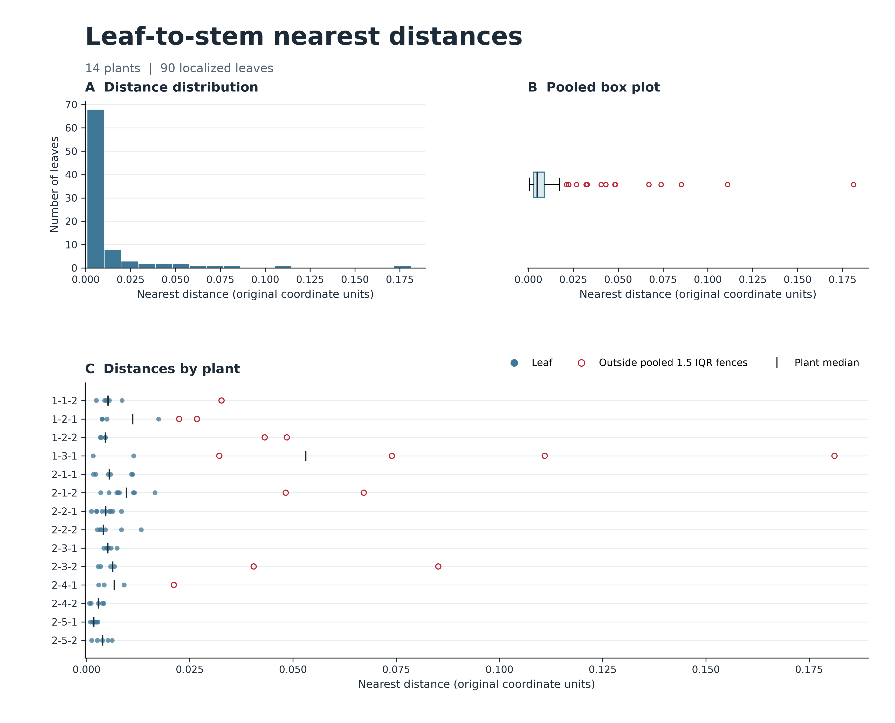

# V1.0 全局最近邻叶基定位实验

运行时间（北京时间） 2026-11-20T14:20:21+08:00。运行时 Git HEAD 为 `a1c0bca2aac6ef7837f9fa667db7483721993997`。下方 SHA-256 记录实际执行的代码及依赖清单，文本统一按 LF 换行计算。
Python 3.14.10，NumPy 2.5.5，SciPy 1.18.1，Matplotlib 3.11.2。

读取到 14 个原始 TXT 和 14 个语义 CSV，对齐通过 14/14 株，共 325,818 行点数据，其中 0 行无有效 XYZ。
输入仅以文件名标识。[输入核验与逐文件 SHA-256](input_manifest.csv)

识别 90 片叶，定位成功 90 片，失败 0 片。另有 0 条植株级失败记录。
行号以 0 为起点，以原始文件首条点数据为第 0 行，CSV 表头和 TXT 的两行头部均排除。
距离单位沿用原始坐标，物理单位待确认。[逐叶结果](nearest_attachment_results.csv)

## 最近距离分布

| 最小值 | Q1 | 中位数 | Q3 | 最大值 | 均值 | 样本标准差 |
|---:|---:|---:|---:|---:|---:|---:|
| 0.00069015981 | 0.0029929695 | 0.0050125319 | 0.0089554289 | 0.1811559 | 0.013582799 | 0.026092081 |

四分位数采用线性插值。叶片距离用于批次描述，独立植株为统计样本单位。

## 逐株核验

| 植株 | 识别叶数 | 成功 | 失败叶数 | 距离中位数 | 最大距离 | 原坐标三维图 |
|---|---:|---:|---:|---:|---:|---|
| 1-1-2 | 6 | 6 | 0 | 0.0051753947 | 0.032698208 | [三维图](visualizations/1-1-2.png) |
| 1-2-1 | 6 | 6 | 0 | 0.011165838 | 0.026741607 | [三维图](visualizations/1-2-1.png) |
| 1-2-2 | 6 | 6 | 0 | 0.0045243679 | 0.048510949 | [三维图](visualizations/1-2-2.png) |
| 1-3-1 | 6 | 6 | 0 | 0.053055339 | 0.1811559 | [三维图](visualizations/1-3-1.png) |
| 2-1-1 | 6 | 6 | 0 | 0.005522652 | 0.011180603 | [三维图](visualizations/2-1-1.png) |
| 2-1-2 | 10 | 10 | 0 | 0.0096324433 | 0.067151577 | [三维图](visualizations/2-1-2.png) |
| 2-2-1 | 9 | 9 | 0 | 0.0046315235 | 0.0084375558 | [三维图](visualizations/2-2-1.png) |
| 2-2-2 | 6 | 6 | 0 | 0.0040423853 | 0.013221851 | [三维图](visualizations/2-2-2.png) |
| 2-3-1 | 7 | 7 | 0 | 0.005143933 | 0.0073619059 | [三维图](visualizations/2-3-1.png) |
| 2-3-2 | 6 | 6 | 0 | 0.0062893636 | 0.085203234 | [三维图](visualizations/2-3-2.png) |
| 2-4-1 | 4 | 4 | 0 | 0.0066599845 | 0.021142117 | [三维图](visualizations/2-4-1.png) |
| 2-4-2 | 5 | 5 | 0 | 0.0028857192 | 0.0041539273 | [三维图](visualizations/2-4-2.png) |
| 2-5-1 | 8 | 8 | 0 | 0.0017522488 | 0.0027103015 | [三维图](visualizations/2-5-1.png) |
| 2-5-2 | 5 | 5 | 0 | 0.0038325766 | 0.0061718476 | [三维图](visualizations/2-5-2.png) |

[逐株统计表](plant_summary.csv) · [机器可读距离统计](distance_summary.json)

## 距离异常和计算失败

以全部成功叶片的 Q1−1.5×IQR 和 Q3+1.5×IQR 为界，区间为 [-0.0059507195, 0.017899118]。共标记 14 片。
异常叶片全部参与统计。异常表示距离超出本批次分布的围栏，定位准确性须通过独立证据验证。
[异常清单](distance_outliers.csv)

| 植株 | 叶号 | 距离 | 叶点行号 | 茎点行号 |
|---|---:|---:|---:|---:|
| 1-1-2 | 6 | 0.032698208 | 13191 | 208 |
| 1-2-1 | 4 | 0.026741607 | 2286 | 240 |
| 1-2-1 | 5 | 0.022454914 | 8995 | 210 |
| 1-2-2 | 5 | 0.048510949 | 13768 | 12566 |
| 1-2-2 | 6 | 0.043153235 | 214 | 12748 |
| 1-3-1 | 2 | 0.11097345 | 1634 | 20158 |
| 1-3-1 | 3 | 0.032158368 | 11621 | 18858 |
| 1-3-1 | 5 | 0.1811559 | 20721 | 20087 |
| 1-3-1 | 6 | 0.073952311 | 22902 | 20412 |
| 2-1-2 | 7 | 0.048245285 | 29589 | 32853 |
| 2-1-2 | 10 | 0.067151577 | 33761 | 31321 |
| 2-3-2 | 3 | 0.040481385 | 15687 | 33675 |
| 2-3-2 | 4 | 0.085203234 | 16335 | 32590 |
| 2-4-1 | 3 | 0.021142117 | 3341 | 5114 |

## 结果解释

最短点对是初始几何估计。叶片贴茎、遮挡、采样疏密和语义边界均会影响点对位置。当前批次缺少独立解剖叶基标注，因此定位成功计数表示计算获得有效点对，实际定位误差待后续验证。

## 运行代码 SHA-256

- src/nearest_attachment.py · `f764fab183e6c88d2c5bd23c9c3bcbd21f6c0305d3df77de45bafb0a4a343e63`
- src/nearest_report.py · `a0655a658d9d5fc1fbd427495186dbdc0367afa8b6f12b11f9dba80a3c853622`
- src/nearest_visualization.py · `0ae821309577ad8fe050e01f3fc48b659f7a013c07c01eb3aea3642633e2453e`
- src/io_utils.py · `8995daac5bf3aec0aa00418b8767770499ac5172a23b9e93b56a7b545c191861`
- requirements.txt · `61fa1973807c5b54a7ac6f46300a124f87d26ba0c5a1676980bcf30f9871eecf`
