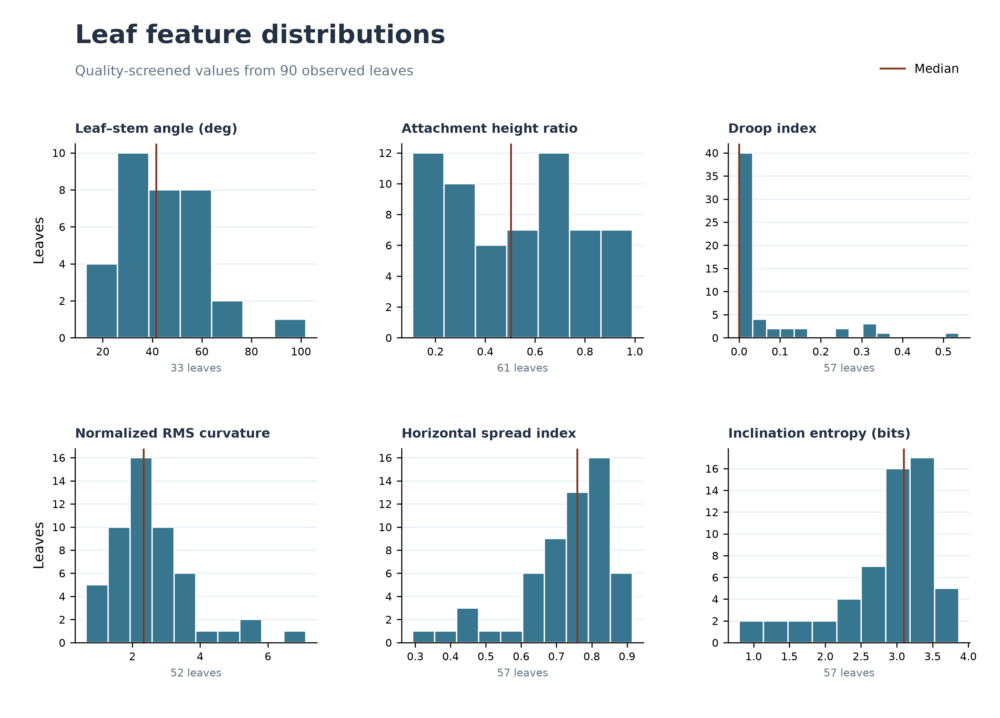
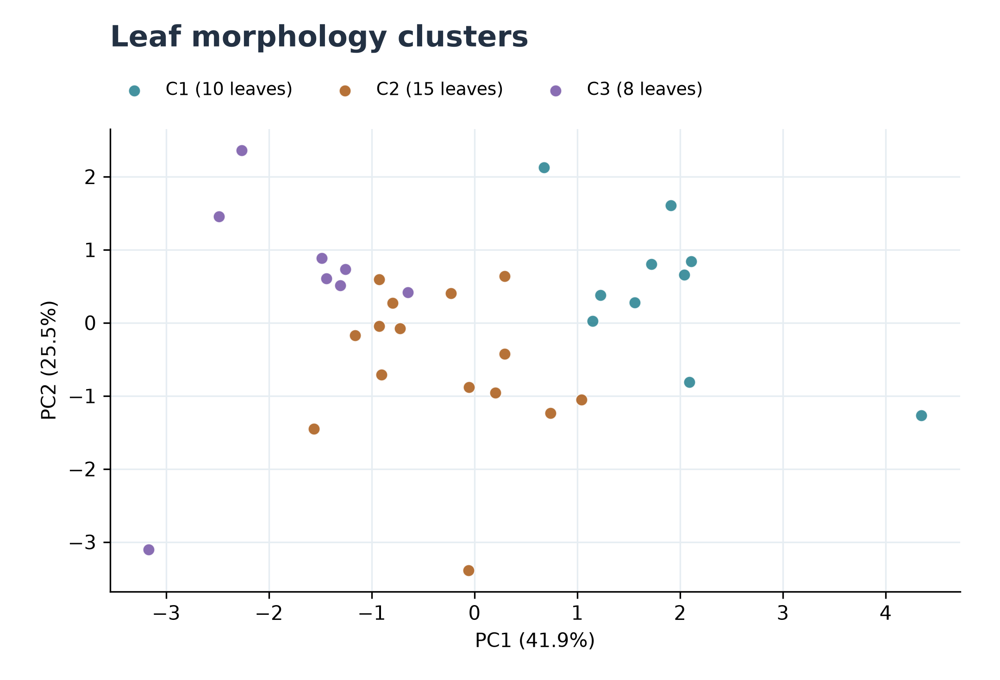

# V1.1 玉米叶片几何与聚类分析

运行于 2026-11-20T18:26:16+08:00。运行代码提交 855568fc3c2a52639ad3cb55aaf6d2e8586bec57。
通过 TXT/CSV 逐行核验 14/14 株，共 325,818 行原始点数据。识别 90 片叶，其中 90 片获得 V1.0 最近点对。

原始坐标物理单位待确认。角度以度计，熵以 bit 计，其他主特征均为无量纲量。
每片叶的保留状态和零基源行号见 [逐叶 CSV](leaf_features.csv)。各项分布基于通过对应质量门槛的叶片，植株为独立观测单位。

## 特征与 Shannon 熵

| 特征 | 有效叶数 | 缺失 | 最小值 | Q1 | 中位数 | Q3 | 最大值 | 均值 |
|---|---:|---:|---:|---:|---:|---:|---:|---:|
| 叶茎夹角（度） | 33 | 57 | 13.249 | 30.149 | 41.56 | 53.037 | 101.97 | 43.277 |
| 归一化着生高度 | 61 | 29 | 0.1084 | 0.25889 | 0.50297 | 0.72717 | 0.99056 | 0.51735 |
| 下垂指数 | 57 | 33 | 0 | 0 | 0 | 0.054954 | 0.53832 | 0.059007 |
| 归一化 RMS 曲率 | 52 | 38 | 0.63118 | 1.8457 | 2.3349 | 3.0725 | 7.1204 | 2.5857 |
| 水平延展指数 | 57 | 33 | 0.29226 | 0.6913 | 0.75874 | 0.8157 | 0.91526 | 0.72726 |
| 倾角 Shannon 熵（bit） | 57 | 33 | 0.79735 | 2.696 | 3.1012 | 3.3605 | 3.8689 | 2.891 |

倾角 Shannon 熵用 18 个等宽角度箱统计可见中线各段的弧长占比。较高值表示弧长分布于更多倾角范围。缺失原因、几何诊断值和各箱概率见 [质量明细](quality_details.json)。

## K-means 与按株稳定性

六项特征齐全的叶片共 33 片，来自 14 株。33 片获得聚类标签。
模型在标准化后的六维特征空间中拟合。二维和三维 PCA 仅用于展示。
类别按簇中心的归一化着生高度从低到高编号。

轮廓系数 0.25472，Calinski–Harabasz 指数 12.16，Davies–Bouldin 指数 1.2563，簇内平方和 109.35。

| 簇 | 叶片数 | 植株数 | 平均高度比 | 平均倾角熵（bit） |
|---|---:|---:|---:|---:|
| C1 | 10 | 6 | 0.25979 | 3.2269 |
| C2 | 15 | 11 | 0.52568 | 2.995 |
| C3 | 8 | 7 | 0.78674 | 2.9037 |

逐株留出完成 14/14 折。训练重叠叶的 ARI 中位数 1，最小值 0.32744，按叶数加权的留出标签一致率 0.84848，各株等权的一致率 0.77381。至少有 2 片留出叶的折的 ARI 中位数为 1。
每折只用余下植株重新训练缩放器与 K-means，用训练重叠部分匹配簇标签。整批模型参与了参照标签生成，因此这些指标衡量组内复算稳定性。

[簇中心](cluster_centers.csv) · [逐株留出结果](cluster_stability.csv) · [模型参数](cluster_model.json)

本机交互输出位于 interactive/。cluster_3d.html 可旋转 PCA 簇图并查阅逐叶特征。plant_geometry_3d.html 可逐株旋转拟合茎线、叶片可见中线和最近点对。

## 逐株结果

| 植株 | 输入状态 | 叶片数 | 最近点对 | 完整特征 | C1 | C2 | C3 | 倾角熵中位数（bit） |
|---|---|---:|---:|---:|---:|---:|---:|---:|
| 1-1-2 | ok | 6 | 6 | 1 | 0 | 0 | 1 | 2.7931 |
| 1-2-1 | ok | 6 | 6 | 2 | 0 | 1 | 1 | 2.7209 |
| 1-2-2 | ok | 6 | 6 | 1 | 0 | 1 | 0 | 2.598 |
| 1-3-1 | ok | 6 | 6 | 1 | 0 | 0 | 1 | 3.2684 |
| 2-1-1 | ok | 6 | 6 | 2 | 1 | 0 | 1 | 3.6074 |
| 2-1-2 | ok | 10 | 10 | 4 | 2 | 1 | 1 | 3.0007 |
| 2-2-1 | ok | 9 | 9 | 3 | 1 | 2 | 0 | 3.3707 |
| 2-2-2 | ok | 6 | 6 | 3 | 0 | 1 | 2 | 2.8801 |
| 2-3-1 | ok | 7 | 7 | 4 | 2 | 2 | 0 | 3.2169 |
| 2-3-2 | ok | 6 | 6 | 2 | 1 | 1 | 0 | 3.1493 |
| 2-4-1 | ok | 4 | 4 | 1 | 0 | 1 | 0 | 2.1103 |
| 2-4-2 | ok | 5 | 5 | 2 | 0 | 2 | 0 | 3.1012 |
| 2-5-1 | ok | 8 | 8 | 6 | 3 | 2 | 1 | 3.126 |
| 2-5-2 | ok | 5 | 5 | 1 | 0 | 1 | 0 | 2.9957 |

[逐株完整统计](plant_summary.csv) · [汇总特征统计](feature_summary.csv) · [原始输入 SHA-256](input_manifest.csv) · [软件版本和运行参数](run_provenance.json)

## 解释范围

各项结果描述通过质量筛查的可见点云几何。最近点对仍是对叶基的初始估计，遮挡或贴茎叶段会造成方向歧义。模型覆盖与缺失情况应结合逐株结果判读。聚类与倾角熵的生物学含义需要独立数据验证。
